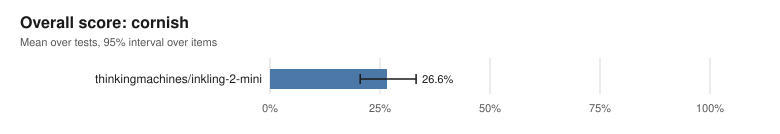
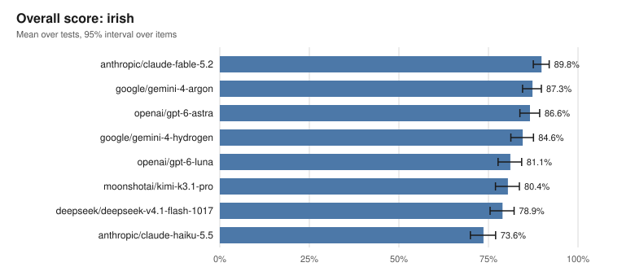

# Teanga Bench leaderboard

Only complete runs on full datasets are ranked. Scores are means over items with a 95% bootstrap interval. Runs on public samples are never ranked and are not comparable with full-set runs. Explanation scores are judge-marked, not human-validated, and shown only for runs that used the current judge pair. This is the v2 leaderboard: 4 core tests, 1 epoch, low reasoning, 1,260 items. It is not comparable with the archived v1 leaderboard.

| Rank | Model | Overall | 95% interval | Cost (USD) | Data |
| --- | --- | --- | --- | --- | --- |
| 1 | thinkingmachines/inkling-2-mini | 50.6% | 47.9% to 53.2% | $0.6569 | full |

## Suite: blas

| Model | Score | 95% interval |
| --- | --- | --- |
| thinkingmachines/inkling-2-mini | 43.1% | 39.9% to 46.1% |

## Suite: tonada

| Model | Score | 95% interval |
| --- | --- | --- |
| thinkingmachines/inkling-2-mini | 73.1% | 68.1% to 77.8% |

## Tests

| Model | blas/morphology | blas/translation | blas/tutor_accuracy | tonada/tutor_accuracy |
| --- | --- | --- | --- | --- |
| thinkingmachines/inkling-2-mini | 39.2% | 47.3% | 42.8% | 73.1% |

## Tutor explanation (judge-marked, not human-validated)

Judges: deepseek/deepseek-v4.1-flash-1017, qwen/qwen3.8-flash. Only runs that used this pair are compared.

| Model | Test | Explanation | 95% interval | Note |
| --- | --- | --- | --- | --- |
| thinkingmachines/inkling-2-mini | blas/tutor_accuracy | 33.0% | 26.3% to 40.2% |  |
| thinkingmachines/inkling-2-mini | tonada/tutor_accuracy | 62.4% | 57.2% to 67.3% |  |

## Charts

