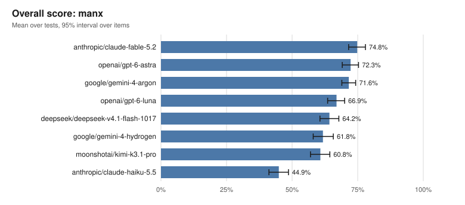
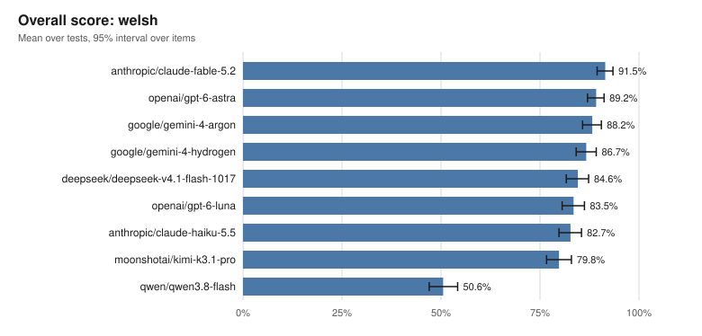

# Teanga Bench leaderboard

Only runs with status complete are ranked. Scores are means over items with a 95% bootstrap interval. Runs on public samples and runs on full sets are not comparable; the data column says which. Explanation scores are judge-marked, not human-validated, and shown only for runs that used the current judge pair.

| Rank | Model | Overall | 95% interval | Cost (USD) | Data |
| --- | --- | --- | --- | --- | --- |
| 1 | anthropic/claude-fable-5.2 | 87.5% | 86.4% to 88.5% | $46.32 | full |
| 2 | openai/gpt-6-astra | 86.0% | 84.9% to 87.1% | $36.70 | full |
| 3 | google/gemini-4-argon | 84.4% | 83.3% to 85.6% | $5.57 | full |
| 4 | google/gemini-4-hydrogen | 82.2% | 81.0% to 83.4% | $38.31 | full |
| 5 | deepseek/deepseek-v4.1-flash-1017 | 78.5% | 77.2% to 79.8% | $0.7675 | full |
| 6 | moonshotai/kimi-k3.1-pro | 78.0% | 76.6% to 79.3% | $34.76 | full |
| 7 | openai/gpt-6-luna | 78.0% | 76.6% to 79.3% | $1.30 | full |
| 8 | anthropic/claude-haiku-5.5 | 72.1% | 70.7% to 73.6% | $1.90 | full |
| - | qwen/qwen3.8-flash (cost_cap_reached) | 48.2% | 46.3% to 50.0% | $2.50 | full |

## Suite: blas

| Model | Score | 95% interval |
| --- | --- | --- |
| anthropic/claude-fable-5.2 | 86.1% | 84.9% to 87.3% |
| openai/gpt-6-astra | 83.6% | 82.3% to 84.9% |
| google/gemini-4-argon | 81.9% | 80.5% to 83.3% |
| google/gemini-4-hydrogen | 78.5% | 77.0% to 80.0% |
| deepseek/deepseek-v4.1-flash-1017 | 75.8% | 74.2% to 77.4% |
| moonshotai/kimi-k3.1-pro | 73.3% | 71.6% to 75.0% |
| openai/gpt-6-luna | 75.6% | 73.9% to 77.2% |
| anthropic/claude-haiku-5.5 | 67.1% | 65.3% to 68.9% |

## Suite: tonada

| Model | Score | 95% interval |
| --- | --- | --- |
| anthropic/claude-fable-5.2 | 91.0% | 89.0% to 92.9% |
| openai/gpt-6-astra | 92.0% | 90.1% to 93.9% |
| google/gemini-4-argon | 90.7% | 88.8% to 92.6% |
| google/gemini-4-hydrogen | 91.4% | 89.4% to 93.3% |
| deepseek/deepseek-v4.1-flash-1017 | 85.1% | 82.8% to 87.3% |
| moonshotai/kimi-k3.1-pro | 89.7% | 87.7% to 91.7% |
| openai/gpt-6-luna | 84.0% | 81.6% to 86.3% |
| anthropic/claude-haiku-5.5 | 84.8% | 82.3% to 87.2% |

## Tests

| Model | blas/lesson_exercises | blas/morphology | blas/round_trip | blas/translation | blas/tutor_accuracy | tonada/exercises | tonada/tutor_accuracy |
| --- | --- | --- | --- | --- | --- | --- | --- |
| anthropic/claude-fable-5.2 | 98.5% | 94.1% | 74.3% | 75.1% | 88.5% | 99.5% | 82.6% |
| openai/gpt-6-astra | 96.6% | 92.5% | 69.3% | 73.1% | 86.5% | 99.0% | 85.1% |
| google/gemini-4-argon | 98.2% | 85.4% | 70.0% | 71.9% | 84.1% | 99.6% | 81.9% |
| google/gemini-4-hydrogen | 96.2% | 84.0% | 61.8% | 65.6% | 84.8% | 98.6% | 84.3% |
| deepseek/deepseek-v4.1-flash-1017 | 94.2% | 80.6% | 66.7% | 68.2% | 69.4% | 97.9% | 72.2% |
| moonshotai/kimi-k3.1-pro | 94.8% | 76.6% | 60.0% | 65.6% | 69.4% | 98.8% | 80.6% |
| openai/gpt-6-luna | 93.6% | 80.5% | 64.5% | 68.0% | 71.3% | 98.0% | 70.0% |
| anthropic/claude-haiku-5.5 | 87.5% | 65.3% | 58.0% | 57.9% | 66.9% | 98.3% | 71.2% |

## Tutor explanation (judge-marked, not human-validated)

Judges: deepseek/deepseek-v4.1-flash-1017, qwen/qwen3.8-flash. Only runs that used this pair are compared.

| Model | Test | Explanation | 95% interval | Note |
| --- | --- | --- | --- | --- |
| anthropic/claude-fable-5.2 | blas/tutor_accuracy | 78.5% | 72.9% to 84.1% |  |
| anthropic/claude-fable-5.2 | tonada/tutor_accuracy | 63.7% | 58.8% to 68.4% |  |
| openai/gpt-6-astra | blas/tutor_accuracy | 69.9% | 63.5% to 76.2% |  |
| openai/gpt-6-astra | tonada/tutor_accuracy | 63.7% | 58.9% to 68.3% |  |
| google/gemini-4-argon | blas/tutor_accuracy | 75.9% | 70.1% to 81.7% |  |
| google/gemini-4-argon | tonada/tutor_accuracy | 61.7% | 56.8% to 66.5% |  |
| google/gemini-4-hydrogen | blas/tutor_accuracy | 73.6% | 67.5% to 79.5% |  |
| google/gemini-4-hydrogen | tonada/tutor_accuracy | 62.9% | 58.0% to 67.7% |  |
| deepseek/deepseek-v4.1-flash-1017 | blas/tutor_accuracy | n/a | n/a | not comparable: not_scored_same_family_as_judge |
| deepseek/deepseek-v4.1-flash-1017 | tonada/tutor_accuracy | n/a | n/a | not comparable: not_scored_same_family_as_judge |
| moonshotai/kimi-k3.1-pro | blas/tutor_accuracy | 61.3% | 55.3% to 67.1% |  |
| moonshotai/kimi-k3.1-pro | tonada/tutor_accuracy | 63.8% | 59.2% to 68.5% |  |
| openai/gpt-6-luna | blas/tutor_accuracy | 57.4% | 50.6% to 64.2% |  |
| openai/gpt-6-luna | tonada/tutor_accuracy | 58.6% | 53.7% to 63.4% |  |
| anthropic/claude-haiku-5.5 | blas/tutor_accuracy | 59.6% | 53.1% to 65.8% |  |
| anthropic/claude-haiku-5.5 | tonada/tutor_accuracy | 62.2% | 57.4% to 66.8% |  |

## Charts

