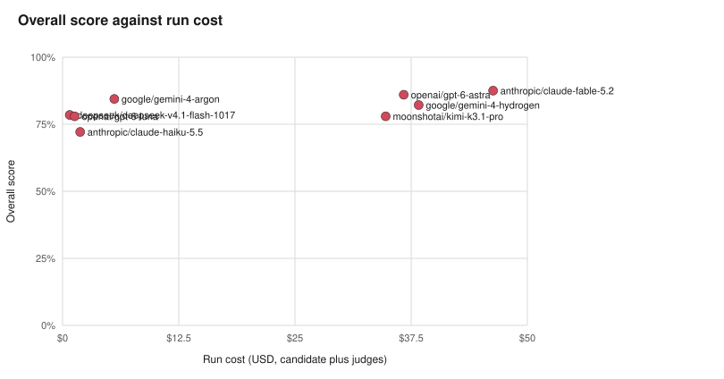

# Teanga Bench leaderboard

Only runs with status complete are ranked. Scores are means over items with a 95% bootstrap interval. Runs on public samples and runs on full sets are not comparable; the data column says which. Explanation scores are judge-marked, not human-validated, and shown only for runs that used the current judge pair.

| Rank | Model | Overall | 95% interval | Cost (USD) | Data |
| --- | --- | --- | --- | --- | --- |
| - | No runs yet | n/a | n/a | n/a | n/a |

## Charts

