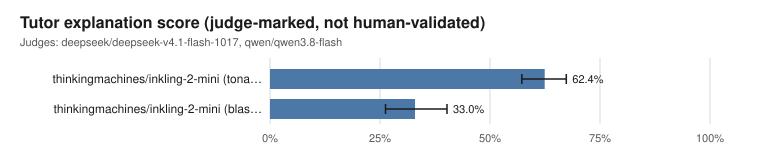
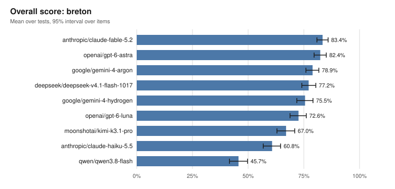
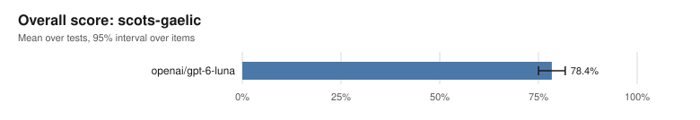
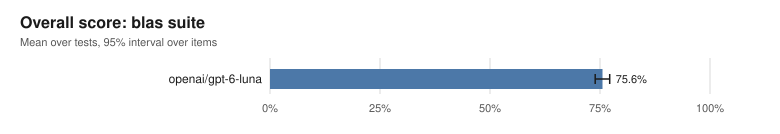

# Teanga Bench leaderboard

Only runs with status complete are ranked. Scores are means over items with a 95% bootstrap interval. Runs on public samples and runs on full sets are not comparable; the data column says which. Explanation scores are judge-marked, not human-validated, and shown only for runs that used the current judge pair.

| Rank | Model | Overall | 95% interval | Cost (USD) | Data |
| --- | --- | --- | --- | --- | --- |
| 1 | openai/gpt-6-luna | 78.0% | 76.6% to 79.3% | $1.30 | full |

## Suite: blas

| Model | Score | 95% interval |
| --- | --- | --- |
| openai/gpt-6-luna | 75.6% | 73.9% to 77.2% |

## Suite: tonada

| Model | Score | 95% interval |
| --- | --- | --- |
| openai/gpt-6-luna | 84.0% | 81.6% to 86.3% |

## Tests

| Model | blas/lesson_exercises | blas/morphology | blas/round_trip | blas/translation | blas/tutor_accuracy | tonada/exercises | tonada/tutor_accuracy |
| --- | --- | --- | --- | --- | --- | --- | --- |
| openai/gpt-6-luna | 93.6% | 80.5% | 64.5% | 68.0% | 71.3% | 98.0% | 70.0% |

## Tutor explanation (judge-marked, not human-validated)

Judges: deepseek/deepseek-v4.1-flash-1017, qwen/qwen3.8-flash. Only runs that used this pair are compared.

| Model | Test | Explanation | 95% interval | Note |
| --- | --- | --- | --- | --- |
| openai/gpt-6-luna | blas/tutor_accuracy | 57.4% | 50.6% to 64.2% |  |
| openai/gpt-6-luna | tonada/tutor_accuracy | 58.6% | 53.7% to 63.4% |  |

## Charts

