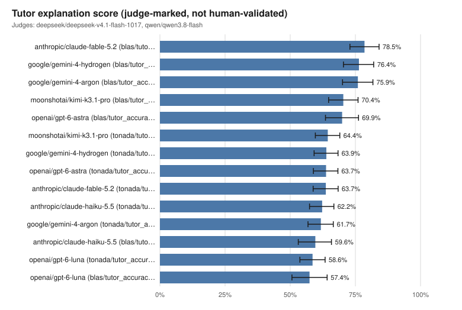
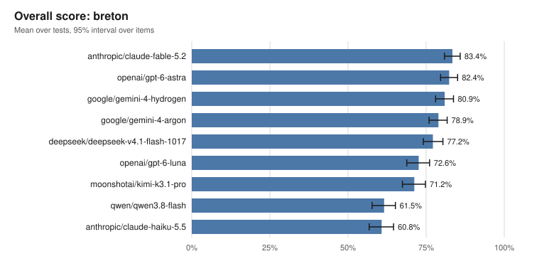
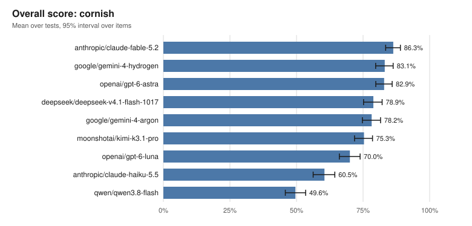
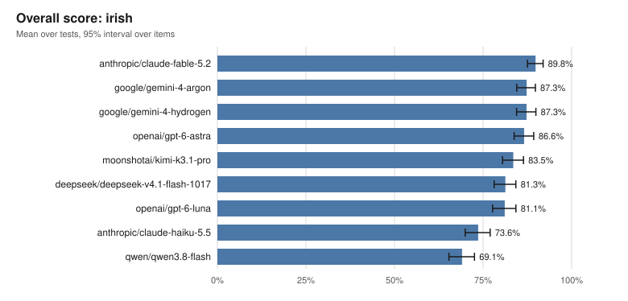
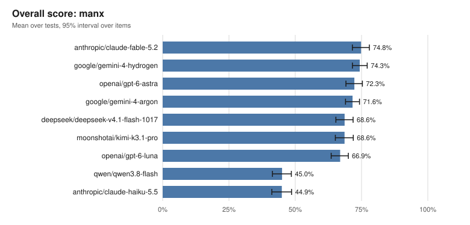
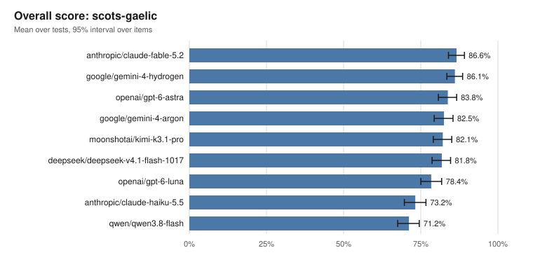
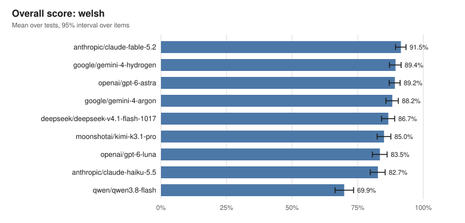
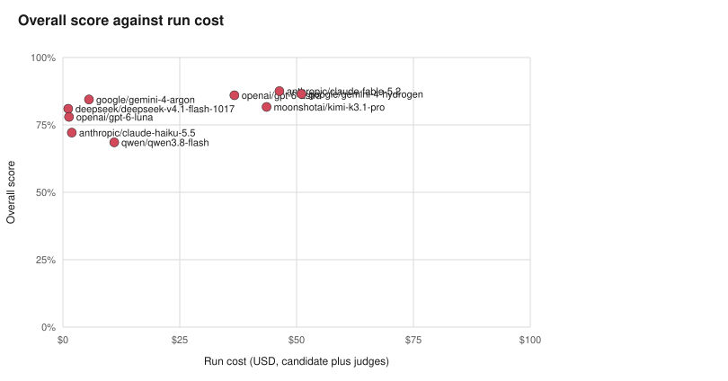
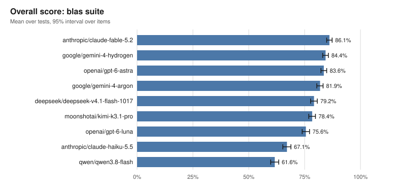
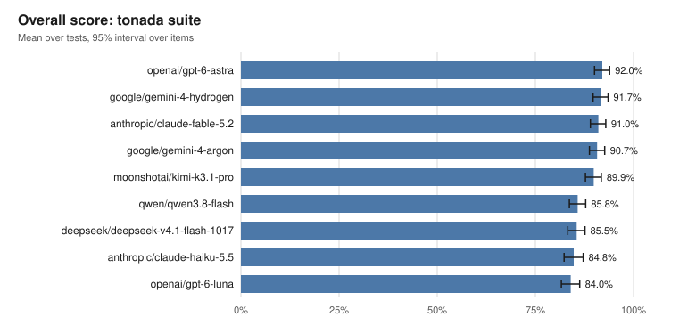

# Teanga Bench leaderboard

Only complete runs on full datasets are ranked. Scores are means over items with a 95% bootstrap interval. Runs on public samples are never ranked and are not comparable with full-set runs. Explanation scores are judge-marked, not human-validated, and shown only for runs that used the current judge pair. This is the archived v1 leaderboard: 7 tests, 3 epochs, provider-default reasoning, 2,260 items. It is not comparable with v2.

| Rank | Model | Overall | 95% interval | Cost (USD) | Data |
| --- | --- | --- | --- | --- | --- |
| 1 | anthropic/claude-fable-5.2 | 87.5% | 86.4% to 88.5% | $46.32 | full |
| 2 | google/gemini-4-hydrogen | 86.5% | 85.4% to 87.5% | $51.05 | full |
| 3 | openai/gpt-6-astra | 86.0% | 84.9% to 87.1% | $36.70 | full |
| 4 | google/gemini-4-argon | 84.4% | 83.3% to 85.6% | $5.57 | full |
| 5 | moonshotai/kimi-k3.1-pro | 81.7% | 80.5% to 82.9% | $43.58 | full |
| 6 | deepseek/deepseek-v4.1-flash-1017 | 81.0% | 79.8% to 82.3% | $1.14 | full |
| 7 | openai/gpt-6-luna | 78.0% | 76.6% to 79.3% | $1.30 | full |
| 8 | anthropic/claude-haiku-5.5 | 72.1% | 70.7% to 73.6% | $1.90 | full |
| 9 | qwen/qwen3.8-flash | 68.5% | 67.1% to 69.9% | $10.98 | full |

## Suite: blas

| Model | Score | 95% interval |
| --- | --- | --- |
| anthropic/claude-fable-5.2 | 86.1% | 84.9% to 87.3% |
| google/gemini-4-hydrogen | 84.4% | 83.1% to 85.6% |
| openai/gpt-6-astra | 83.6% | 82.3% to 84.9% |
| google/gemini-4-argon | 81.9% | 80.5% to 83.3% |
| moonshotai/kimi-k3.1-pro | 78.4% | 76.9% to 79.9% |
| deepseek/deepseek-v4.1-flash-1017 | 79.2% | 77.7% to 80.7% |
| openai/gpt-6-luna | 75.6% | 73.9% to 77.2% |
| anthropic/claude-haiku-5.5 | 67.1% | 65.3% to 68.9% |
| qwen/qwen3.8-flash | 61.6% | 59.8% to 63.4% |

## Suite: tonada

| Model | Score | 95% interval |
| --- | --- | --- |
| anthropic/claude-fable-5.2 | 91.0% | 89.0% to 92.9% |
| google/gemini-4-hydrogen | 91.7% | 89.7% to 93.5% |
| openai/gpt-6-astra | 92.0% | 90.1% to 93.9% |
| google/gemini-4-argon | 90.7% | 88.8% to 92.6% |
| moonshotai/kimi-k3.1-pro | 89.9% | 87.8% to 91.8% |
| deepseek/deepseek-v4.1-flash-1017 | 85.5% | 83.3% to 87.6% |
| openai/gpt-6-luna | 84.0% | 81.6% to 86.3% |
| anthropic/claude-haiku-5.5 | 84.8% | 82.3% to 87.2% |
| qwen/qwen3.8-flash | 85.8% | 83.7% to 87.8% |

## Tests

| Model | blas/lesson_exercises | blas/morphology | blas/round_trip | blas/translation | blas/tutor_accuracy | tonada/exercises | tonada/tutor_accuracy |
| --- | --- | --- | --- | --- | --- | --- | --- |
| anthropic/claude-fable-5.2 | 98.5% | 94.1% | 74.3% | 75.1% | 88.5% | 99.5% | 82.6% |
| google/gemini-4-hydrogen | 97.3% | 91.1% | 73.0% | 72.4% | 88.1% | 99.0% | 84.4% |
| openai/gpt-6-astra | 96.6% | 92.5% | 69.3% | 73.1% | 86.5% | 99.0% | 85.1% |
| google/gemini-4-argon | 98.2% | 85.4% | 70.0% | 71.9% | 84.1% | 99.6% | 81.9% |
| moonshotai/kimi-k3.1-pro | 95.8% | 82.1% | 65.3% | 69.4% | 79.3% | 99.1% | 80.6% |
| deepseek/deepseek-v4.1-flash-1017 | 95.6% | 87.0% | 68.5% | 68.8% | 76.1% | 98.1% | 73.0% |
| openai/gpt-6-luna | 93.6% | 80.5% | 64.5% | 68.0% | 71.3% | 98.0% | 70.0% |
| anthropic/claude-haiku-5.5 | 87.5% | 65.3% | 58.0% | 57.9% | 66.9% | 98.3% | 71.2% |
| qwen/qwen3.8-flash | 90.6% | 50.6% | 52.2% | 56.9% | 58.0% | 98.7% | 72.9% |

## Tutor explanation (judge-marked, not human-validated)

Judges: deepseek/deepseek-v4.1-flash-1017, qwen/qwen3.8-flash. Only runs that used this pair are compared.

| Model | Test | Explanation | 95% interval | Note |
| --- | --- | --- | --- | --- |
| anthropic/claude-fable-5.2 | blas/tutor_accuracy | 78.5% | 72.9% to 84.1% |  |
| anthropic/claude-fable-5.2 | tonada/tutor_accuracy | 63.7% | 58.8% to 68.4% |  |
| google/gemini-4-hydrogen | blas/tutor_accuracy | 76.4% | 70.4% to 82.0% |  |
| google/gemini-4-hydrogen | tonada/tutor_accuracy | 63.9% | 59.2% to 68.3% |  |
| openai/gpt-6-astra | blas/tutor_accuracy | 69.9% | 63.5% to 76.2% |  |
| openai/gpt-6-astra | tonada/tutor_accuracy | 63.7% | 58.9% to 68.3% |  |
| google/gemini-4-argon | blas/tutor_accuracy | 75.9% | 70.1% to 81.7% |  |
| google/gemini-4-argon | tonada/tutor_accuracy | 61.7% | 56.8% to 66.5% |  |
| moonshotai/kimi-k3.1-pro | blas/tutor_accuracy | 70.4% | 64.7% to 76.0% |  |
| moonshotai/kimi-k3.1-pro | tonada/tutor_accuracy | 64.4% | 59.6% to 69.0% |  |
| deepseek/deepseek-v4.1-flash-1017 | blas/tutor_accuracy | n/a | n/a | not comparable: not_scored_same_family_as_judge |
| deepseek/deepseek-v4.1-flash-1017 | tonada/tutor_accuracy | n/a | n/a | not comparable: not_scored_same_family_as_judge |
| openai/gpt-6-luna | blas/tutor_accuracy | 57.4% | 50.6% to 64.2% |  |
| openai/gpt-6-luna | tonada/tutor_accuracy | 58.6% | 53.7% to 63.4% |  |
| anthropic/claude-haiku-5.5 | blas/tutor_accuracy | 59.6% | 53.1% to 65.8% |  |
| anthropic/claude-haiku-5.5 | tonada/tutor_accuracy | 62.2% | 57.4% to 66.8% |  |
| qwen/qwen3.8-flash | blas/tutor_accuracy | n/a | n/a | not comparable: not_scored_same_family_as_judge |
| qwen/qwen3.8-flash | tonada/tutor_accuracy | n/a | n/a | not comparable: not_scored_same_family_as_judge |

## Charts

